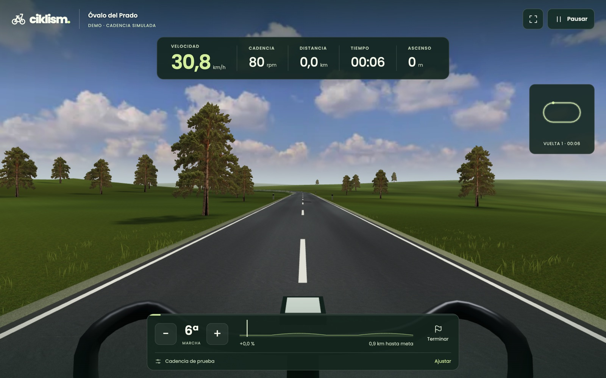
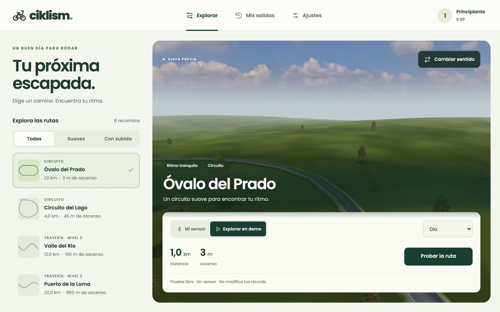
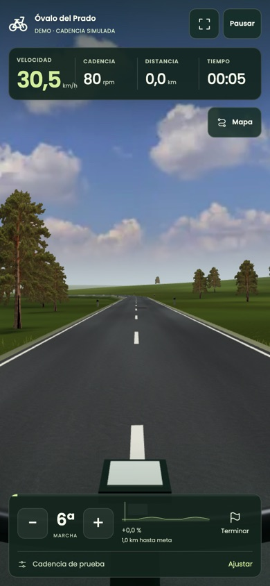

# Ciklism

An indoor cycling viewer for web, iPhone and Android. A Bluetooth cadence sensor drives a first-person ride through a 3D landscape. One TypeScript codebase covers all three: Babylon.js renders the scene and Capacitor wraps it for mobile.

**Live demo:** [pscactux.github.io/ciklism](https://pscactux.github.io/ciklism/). It runs without a sensor: press *Probar la ruta*.



<p>
  
  
</p>

The interface is in Spanish. Code, comments and docs are in English.

## Features

- Six routes from 1 to 20 km (circuits and point-to-point), each rideable in reverse and at three times of day.
- First-person camera with handlebar, crank-driven sway, terrain, forest, river, lake and reservoir.
- Bluetooth Cycling Speed and Cadence (CSC) sensors. Browsers use Web Bluetooth; the iOS and Android apps use the native BLE plugin. Includes bounded automatic reconnection and a manual reconnect.
- Nine gears and per-sensor calibration. When you stop pedalling, coasting is modelled with gravity, rolling resistance and air drag.
- A clearly labelled demo mode with a simulated cadence slider. Demo rides never count towards records or XP.
- Laps, sectors, personal records and a ghost of your best lap across sessions.
- Local history with charts, XP, levels, unlockable routes and achievements. Everything is stored in IndexedDB, with JSON export/import that is idempotent on re-import.
- Auto-pause when the app is hidden. Recovery checkpoints every 15 s, so an unexpected close still saves the ride.
- Installable PWA that works offline after the first visit.
- Keyboard controls: `+`/`↑` and `-`/`↓` shift gears, space pauses. The same controls are available as touch buttons.

[`pedal-ios/`](pedal-ios/README.md) is a separate small SwiftUI app. It turns an iPhone strapped to your shoe into a CSC cadence sensor, using the accelerometer.

## Run it

Requires Node 22.12 or later (see `.node-version`).

```sh
npm ci
npm run dev        # http://localhost:5184
```

Press **Probar la ruta** to ride with simulated cadence. Connecting a real sensor in the browser needs HTTPS (or localhost) and a browser with Web Bluetooth, such as Chrome or Edge. Safari has no Web Bluetooth, so on iPhone you need the native app.

```sh
npm run typecheck
npm test                     # unit tests (Vitest)
npm run build                # static site in dist/
npx playwright install chromium
npm run test:e2e             # browser tests against the production build
```

The build uses a relative base path, so `dist/` works at a domain root, under a sub-path such as GitHub Pages' `/ciklism/`, and inside the Capacitor containers. `.github/workflows/pages.yml` builds and deploys it on every push to `main`.

### Mobile apps

```sh
npm run sync       # build the web app and copy it into both native projects
npm run ios        # open Xcode (Xcode 26+, iOS 15.4+)
npm run android    # open Android Studio (SDK 36, JDK 21)
```

To install on an iPhone, pick your own signing team in Xcode. Bluetooth cannot be tested in the iOS simulator. For a debug APK, run `./gradlew :app:assembleDebug` from `android/`.

## How it works

**Cadence from the CSC protocol.** A CSC sensor does not send rpm. It sends a cumulative crank revolution count and the time of the last crank event, both 16-bit and in 1/1024 s units. Cadence is the delta between two notifications, with wrap-around handled by masking. Absurd values from a sensor reboot are dropped so they cannot launch the rider:

```ts
const revolutions = (m.revolutions - previous.revolutions) & 0xffff;
const time = (m.time - previous.time) & 0xffff;
const rpm = revolutions * 60 * 1024 / time;
return rpm <= 250 ? rpm : null;
```

**Fixed-step physics.** `RideClock` advances the simulation in fixed 1/30 s steps, whatever the display refresh rate, and discards gaps longer than one second. A suspended tab therefore never earns kilometres. While you pedal, speed eases towards `cadence × gear ratio × calibration`. Without cadence, speed follows a coast model with gravity along the slope, rolling resistance and quadratic drag (`src/domain/ride.ts`).

**One renderer, phone-sized budget.** The scene is built for phones first (details in [docs/rendering.md](docs/rendering.md)):

- Terrain is generated only in a corridor around the road. Tiles share their boundary vertices, so different resolutions never crack at the seams.
- Trees are instanced photographic cutouts.
- Static shadows are **baked offline** into 18 small WebP lightmaps (6 routes × 3 times of day). Map names carry a fingerprint of the route and of the bake recipe, and a unit test fails if any map is stale. At runtime there is no shadow pass: shadows cost one texture lookup.
- Presentation is capped and resolution adapts to missed frames. Preview and pause render only when something changes.

**Platform boundaries.** `src/domain` has no Babylon or Capacitor imports. Its tests cover the CSC parser, gears, coasting, frame-rate independence, laps and ghosts, rewards and backup validation. `src/platform/cadence.ts` wraps the Capacitor BLE plugin, which uses Web Bluetooth in the browser and native BLE in the apps. Tests run that wrapper against a fake client to check subscription, reconnection and cancellation. The same bundle runs in a browser tab or inside the native shells.

## Project structure

| Path | Contents |
| --- | --- |
| `src/domain` | Ride physics, CSC parsing, laps and ghost, sessions, progress. Platform-independent |
| `src/render` | Babylon scene, terrain and road geometry, vegetation, sky, materials, frame budget |
| `src/platform` | BLE cadence source and IndexedDB storage |
| `src/routes` | Route JSON files and the catalogue |
| `src/ui`, `src/main.ts` | Responsive UI and session orchestration |
| `public/` | Textures, baked lightmaps and fonts (with their licenses) |
| `scripts/` | Lighting baker, benchmarks, visual review and asset preparation scripts |
| `tests/` | Vitest unit tests and Playwright end-to-end tests |
| `ios/`, `android/` | Capacitor containers; both load the same `dist/` |
| `pedal-ios/` | Companion iPhone app that emits cadence over Bluetooth |

## Limitations

- History is local to each browser or device. There is no cloud sync.
- Rendering has been measured on desktop Chromium, emulated phone viewports and the iOS simulator. Sustained performance, battery use and real Bluetooth sensors have not been validated across a range of physical phones.
- Trees are cutouts, not full 3D models, and the landscapes are procedural, not real places.
- The apps have not been published to any store.

## License

MIT. Third-party textures are CC0 from Poly Haven, and Poppins is under the SIL OFL; see `public/textures/README.md` and `public/fonts/README.md`.
