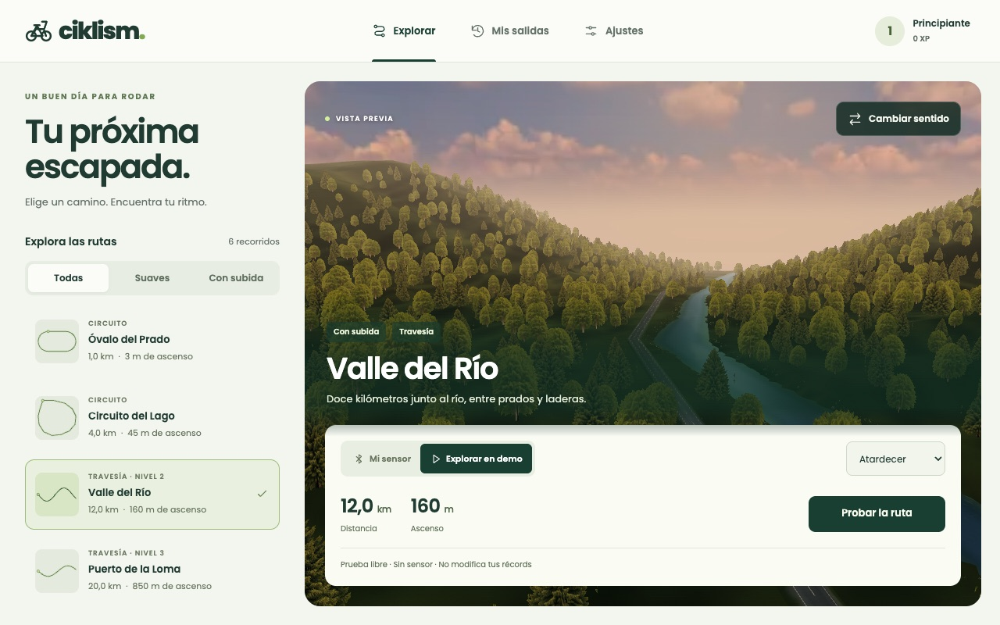

# Rendering notes

One Babylon.js scene serves the web build and both Capacitor containers. These
notes summarise the choices that keep it usable on phones. They are condensed
from the development log, not a full spec.

## Routes

Distances are measured along the geometry the rider follows.

| Route | Type | Distance | Climb | Scenery |
| --- | --- | ---: | ---: | --- |
| Óvalo del Prado | Circuit | 1 km | 3 m | Open meadow, a few trees |
| Circuito del Lago | Circuit | 4 km | 45 m | Pines and a turquoise lake |
| Vuelta al Embalse | Circuit | 8 km | 170 m | Reservoir, dry slopes, rocks |
| Valle del Río | Point to point | 12 km | 160 m | River, banks, wooded slopes |
| Puerto de la Ermita | Circuit | 15 km | 550 m | Warm hills and a chapel |
| Puerto de la Loma | Point to point | 20 km | 850 m | Rocky mountain slopes |

Landscapes are procedural, not geographic reconstructions. Routes carry a
`revision`; records are keyed by `route@revision`, so a reshaped course never
compares times with the old one while history and XP are kept.

## Geometry

- Terrain is built only in a corridor around the road, in 192 m tiles. Tiles
  share boundary vertices; far tiles use a coarser interior but keep the fine
  edge, so there are no cracks or lighting seams between resolutions.
- A single height field drives terrain, banks, water and the offline baker, so
  overlapping legs of a circuit cannot cover each other.
- Construction yields to the browser between tiles. Reversing a route reuses
  the same meshes and lightmap; only the rider and camera change.
- Trees are crossed photographic cutouts with thin instances per spatial batch
  (six triangles near the rider, four far away, 3D bark close by). Each batch
  owns its geometry because Babylon stores thin-instance matrices there.
- Water is opaque with animated normals in the existing pass: no reflection
  camera, no extra render target.

## Lighting

Static shadows are baked offline: 18 WebP maps (6 routes × 3 times of day,
about 900 KB in total). There is no `ShadowGenerator` at runtime.

- **Bake time:** tree crowns projected onto the height field, fixed penumbra and
  contact occlusion under trees.
- **Route preparation:** diffuse sun and sky contribution stored in the vertex
  colours of terrain, verges and road paint.
- **While riding:** one lightmap lookup (`lightmapTexture` with
  `useLightmapAsShadowmap`), textures and fog. Asphalt keeps its normal map and
  reflections; moving objects keep real lights.

Sun direction and tree placement are shared code between baker and renderer.
Map file names contain a fingerprint of route and recipe, and a unit test fails
when a map is stale. Regenerate with `npm run dev` and `npm run bake:lighting`.

## Frame budget

- Physics always runs at a fixed 30 Hz step (`RideClock`), independent of the
  display refresh rate. A tab resumed after more than one second does not earn
  distance for the time it was hidden.
- Presentation is capped (30 fps on touch devices, 60 on desktop in Auto) and
  the internal resolution adapts: fast to degrade, slow to recover. The budget
  watches both CPU submission cost and missed presentation intervals, because
  GPU work is asynchronous and timing `scene.render()` alone misses a saturated GPU.
- The **Saver** profile lowers resolution, detail distance and normal maps; baked
  shadows are kept.
- Preview and pause render on change only, never continuously.
- Instead of an unbounded `scene.whenReadyAsync()`, only the materials of meshes
  the camera selects are awaited, and each wait has a 15 s limit with a Retry
  button, so a GPU that cannot compile a material never blocks the menu.

## Measurement

A software-rendered benchmark (Chromium + SwiftShader, 960×640, DPR 1, 80
frames along the first 300 m of a route) was used to compare versions. This run
predates the baked lighting and the larger landscapes:

| Metric | First shared viewer | Optimised, High | Optimised, Saver |
| --- | ---: | ---: | ---: |
| Median frame time | 43.5 ms | 36.5 ms | 20.0 ms |
| 95th percentile | 48.9 ms | 41.9 ms | 21.0 ms |
| Active triangles | 133,312 | 20,706 | 19,332 |

These numbers are relative comparisons on a CPU rasteriser, not phone GPU,
battery or thermal measurements. To reproduce: `npm run dev`, then
`node scripts/benchmark.mjs current-high high`.

## Known limits

Trees are cutouts with some lighting baked into the photo, the sky is a static
panorama, and shadows of moving objects are not baked. Sustained performance,
battery use and Bluetooth have only been checked in simulators and emulated
viewports, not across a range of physical phones.
